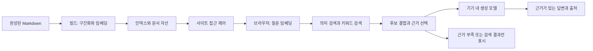

# Doxen 문서 도우미 RAG 시스템 설계

상태: **설계 목표 및 실험적 구현**

작성일: 2026-11-24

대상: Doxen 개발자와 문서 사이트 운영자

> 현재 실험적 구현은 `client/rag.js`, `client/rag-worker.js`, `client/assistant.js`를 참조한다. 아래 내용은 목표 설계이며 전부 구현된 것은 아니다. 문서 임베딩은 빌드 시점이 아닌 질문 시 키워드 후보 최대 24개에 대해 브라우저 메모리에서 계산한다. 대화 기록은 현재 탭의 세션 저장소에 보관한다. 모델 버전 고정·주장 단위 근거 검증·실제 한국어 품질 및 WebGPU 생성 검증은 아직 수행하지 않았다. 생성 모델을 사용할 수 없을 때는 검색 결과를 표시한다.

## 1. 목적과 범위

완성된 문서를 기반으로 사용자가 사이트의 플로팅 패널에서 자연어로 질문하고, 문서에 근거한 답변과 해당 위치를 확인한다. 사용자는 문서를 일일이 탐색하지 않아도 된다. 문서 변경은 재빌드 후 답변에 반영한다.

필수 조건은 다음과 같다.

- 별도 AI API 사용료와 사용자별 AI 구독 연결 없이 동작한다. AI 추론은 사용자 기기에서 수행한다.
- 공개 문서와 인증된 비공개 문서를 지원한다. 현재 사이트가 허용하는 범위를 넘는 문서는 검색하거나 제공하지 않는다.
- 검색 결과를 단순히 나열하는 데서 끝내지 않고, 근거를 바탕으로 답변을 생성하고 출처로 이동할 수 있게 한다.
- 근거가 부족하면 추측 대신 찾지 못했다고 알린다. 검색 모델과 생성 모델은 한국어를 우선 평가한다.
- 플로팅 패널의 시각 디자인은 제공받은 ‘문서 도우미 · 플로팅 패널’을 기준으로 한다. 계정 연결이 없는 실제 기능에 맞게 문구와 상태는 조정한다.

API 비용이 없다는 것은 전체 비용이 0원이라는 뜻이 아니다. 최초 모델 다운로드, 빌드 시간, 저장 용량과 호스팅 트래픽 및 사용자 기기 자원이 필요하다. 기기가 요구 조건을 충족하지 않으면 생성형 답변 대신 검색 결과를 제공한다.

## 2. 현재 구현과 차이

| 항목 | 현재 코드 | 제안 |
| --- | --- | --- |
| 문서 수집 | `src/content.js`가 Markdown을 제목·본문 섹션으로 추출하고, 홈 문서를 별도로 수집한다. | 구조를 보존하는 검색 구간과 인덱스를 빌드한다. |
| 검색 | `client/search.js`는 정규화된 모든 검색어가 제목 또는 본문에 포함되는 섹션을 찾는다. | 키워드와 의미 검색을 결합하고 결과를 재정렬한다. |
| 빌드 | `src/build.js`가 정적 `site.json`과 HTML·자산을 생성한다. | 같은 배포 단위에 버전이 맞는 인덱스를 추가한다. |
| 비공개 배포 | `src/deploy.js`가 모든 경로에 Worker를 적용하고, `src/access-worker.js`가 Access JWT와 이메일을 검사한다. | 인덱스와 근거 원문에도 동일한 보호를 적용하고 우회 경로를 시험한다. |
| AI 기능 | 문서 답변을 생성하는 RAG 및 브라우저 내 모델 연결은 없다. | 검증된 모델과 런타임을 선택한 뒤 별도 기능으로 구현한다. |

현재 XLSX는 문서 목록에 포함되지만 `sections`가 비어 있다. API 참조는 `src/api.js`에서 검색용 섹션이 추가된다. 현재 전체 검색은 `site.documents`를 대상으로 하므로 별도 `home`의 검색 포함 여부를 명시적으로 정해야 한다. RAG 1차 범위는 **Markdown과 홈 문서**로 제안하며, API 참조·스프레드시트·PDF·이미지는 검색 품질 및 추출 정책을 검증한 후 확장한다. 범위 밖 자료가 있을 때 패널에서 명확히 알린다.

## 3. 목표 구현 수준

| 단계 | 제공 기능 | 완료 판단 |
| --- | --- | --- |
| 0. 타당성 검증 | 한국어 임베딩·생성 모델 후보, 브라우저 실행, 실제 문서 평가 | 기기별 속도·메모리와 검색·답변 품질을 측정하고 모델 선정 여부를 결정한다. |
| 1. 검색 | 문서 구간화, 키워드·의미 검색, 근거 발췌와 링크 | 평가 질문에서 관련 근거를 찾으며, 권한 없는 접근을 차단한다. |
| 2. RAG | 로컬 생성 모델, 근거 기반 답변, 출처, 근거 부족 처리 | 검색과 답변 평가 및 기기별 사용성 기준을 통과한다. |
| 3. 고도화 | 후속 질문, 검색 재시도, 선택적 재정렬, 운영 평가 | 단계 2의 결함을 측정해 효과가 입증된 항목만 추가한다. |

**출시 목표는 단계 2다.** 단계 1만 성공하면 검색 기능이지 완성된 RAG가 아니다. 단계 0에서 모델이 기준을 충족하지 못하면 RAG가 완성됐다고 표시하지 않고, 검색 전용 기능으로 제한할지 별도로 결정한다.

## 4. 구성과 데이터 흐름

**빌드 시:** 문서 수집 → 구조 단위 구간화 → 구간별 임베딩 생성 → 구간 메타데이터와 키워드 인덱스 생성 → 모델·인덱스 버전 기록 → 기존 빌드와 함께 배포한다. 임베딩은 빌드 환경에서 로컬 실행하며, 외부 유료 임베딩 API는 사용하지 않는다.

**질문 시:** 인증된 브라우저에서 질문과 현재 범위를 수집 → 질문 임베딩 → 두 검색 결과 결합 → 중복 제거와 근거 선택 → 로컬 생성 → 출처 검증 → 답변·링크 출력한다. 별도의 AI 요청 서버나 API 키는 전제로 하지 않는다.

## 5. 인덱싱 설계

### 구간 단위

- Markdown 파싱 결과에서 문서 제목, 상위 제목 경로, 섹션 앵커를 유지한다. 문단을 기본 단위로 묶고 지나치게 긴 구간만 나눈다.
- 초기 실험값으로 **구간당 300~500 토큰, 연속 구간 겹침 50 토큰**을 사용한다. 숫자는 목표가 아닌 조정 가능한 평가 시작점이며, 실제 선택 모델의 토크나이저와 최대 입력 길이에 맞춰 확정한다.
- 코드 블록은 가능한 한 묶어 유지하고, 너무 긴 코드는 경계에서 나눈다. 표는 헤더와 행의 관계를 유지하고 긴 표는 헤더를 반복해 분할한다.
- 빈 구간은 제외한다. 제목만 있거나 질문과 무관한 반복 탐색 요소가 후보를 지배하지 않도록 평가한다.
- 각 구간에 문서 ID, 제목 경로, 앵커, 구간 ID, 본문, 내용 해시, 문서 버전을 둔다. URL은 기존 `route`와 동일한 해시 라우팅 규칙으로 만들고 하위 경로 배포에서도 검증한다.

### 임베딩과 갱신

- 한국어를 지원하는 소형 다국어 임베딩 모델을 후보로 평가한다. 모델명·정밀도·라이선스는 검증 전 확정하지 않는다. 문서와 질문에 같은 모델·전처리 규칙을 사용한다.
- 모델 및 토크나이저 버전, 구간화 규칙과 인덱스 스키마를 매니페스트에 기록한다. 어느 하나라도 맞지 않으면 잘못된 조합으로 검색하지 않는다.
- 내용 해시가 같은 구간의 임베딩을 재사용하는 증분 빌드를 고려한다. 삭제된 문서와 구간은 새 인덱스에서 제거한다. 변경 실패 시 이전 일관된 결과를 유지하는 기존 빌드 원칙을 따른다.
- 모델 파일은 버전 고정 및 무결성 검증을 전제로 자체 호스팅을 우선 검토한다. 빌드 시 모델 다운로드와 패키징, 라이선스·재배포 조건은 따로 검증한다.

## 6. 검색과 근거 선택

1. 질문을 정규화하고 길이를 제한한다. 현재 문서 범위 우선 여부는 사용자에게 표시한다.
2. 의미 검색은 질문 벡터와 구간 벡터의 유사도를 비교한다. 키워드 검색은 정확한 용어·명령어·오류 코드와 한국어 표현을 놓치지 않도록 사용한다.
3. 초기 후보는 각 검색 방식에서 상위 20개씩 가져오고, 순위 기반 결합(RRF 등)을 실험한다. 기존 검색의 ‘모든 단어 포함’ 조건은 자연어 질문에서 결과가 없을 수 있으므로 별도 개선안을 평가한다.
4. 중복 구간과 겹치는 부분을 정리하고 필요하면 인접 문단을 포함한다. 한 문서의 반복 결과가 모든 후보를 차지하지 않게 제한한다.
5. 답변에 사용할 근거는 초기 실험값으로 최대 4~6개 구간 및 모델 입력 예산 내로 제한한다. 숫자는 평가로 조정한다. 재정렬 모델은 정확도 향상이 지연과 다운로드 증가를 정당화할 때만 도입한다.
6. 점수와 근거 부족 판단 기준은 평가 집합에서 정한다. 유사도 점수만으로 답변의 진실성을 보장하지 않는다.

매 질문마다 문서 전체를 생성 모델에 넣지 않는다. 검색을 거쳐 필요한 구간만 전달하고 질문·대화 이력·출력 길이에 각각 예산을 둔다. 검색 단계의 로컬 임베딩도 연산 자원을 사용하므로 처리량과 지연을 측정한다.

## 7. 답변 생성과 대화

- 한국어 품질과 기기 실행 가능성을 검증한 로컬 생성 모델을 사용한다. 실행 방식과 모델은 단계 0 결과에 따라 결정하며 특정 브라우저나 모바일에서 동작한다고 가정하지 않는다.
- 지침은 ‘제공된 근거에 있는 정보만 사용하고 근거가 없으면 모른다고 답하기’다. 문서 본문을 명령이 아닌 데이터로 취급하고, 문서에 포함된 지시가 시스템 지침을 덮지 못하도록 한다. 이 지침만으로 모든 프롬프트 인젝션이 차단되지는 않으므로 공격 사례로 시험한다.
- 근거마다 내부 식별자를 부여하고, 답변의 각 주장과 출처를 연결한다. 모델이 만든 링크를 신뢰하지 않고 검색 결과의 실제 ID·URL과 대조해 표시한다. 유효하지 않은 출처는 제거하고 필요하면 답변을 보류한다.
- 질문이 모호하거나 근거가 충돌하면 확인 질문 또는 충돌 사실과 각 출처를 보여준다. 검색 결과 없음과 근거 부족을 구분한다.
- 초기에는 대화 이력을 현재 탭 메모리에만 유지하고 새 대화·삭제를 제공한다. 후속 질문은 최근 질문과 답변의 필요한 범위만 사용해 검색하되, 이전 답변을 새로운 근거로 취급하지 않는다. 이력 유지 범위와 저장 정책은 사용자에게 표시한다.
- 모델 준비, 다운로드 진행, 검색 중, 답변 생성 중, 중단, 오류 및 검색 전용 상태를 표시한다. 생성 중단 시 작업을 취소하고 패널을 다시 사용할 수 있어야 한다.

## 8. 비공개 문서와 데이터 보호

- 인덱스, 구간 원문, 매니페스트 등 문서를 유추할 수 있는 모든 산출물은 원본과 동일한 인증 경로에서 제공한다. 벡터도 민감할 수 있으므로 공개 파일로 간주하지 않는다.
- 현재 Cloudflare Worker는 이메일 허용 목록을 바탕으로 사이트 단위 접근을 검사한다. 이 사실은 **문서별·사용자별 권한을 지원한다는 뜻이 아니다**. 서로 다른 열람 권한이 필요한 사이트에는 권한별 인덱스와 서버 측 검증이 별도로 필요하며 1차 지원 범위에서 제외한다.
- 다른 정적 호스팅의 접근 제어는 Doxen이 자동으로 보장할 수 없다. 운영자가 문서와 인덱스의 보호를 구성해야 하며, 설정 가이드와 테스트를 제공한다.
- 사용자 질문, 대화 이력과 검색 구간은 기기에서 처리하고 외부 AI 서비스로 전송하지 않는다. 모델 다운로드 서버와 일반 호스팅 요청에서 발생하는 네트워크 접속은 별개로 명시한다. 분석·로그 전송은 기본 비활성화한다.
- 권한 취소가 이미 내려받은 문서·인덱스를 회수하지는 못한다. 공유 기기, 브라우저 캐시, IndexedDB, 서비스 워커와 로그아웃 후 잔존을 시험하고 저장 범위를 최소화한다. 모델 캐시와 문서 데이터 캐시를 구분한다.
- 접근 거부, 만료 세션, 다른 사용자로 전환, 직접 자산 URL 요청과 인증 우회 시나리오를 출시 차단 조건으로 검증한다.

## 9. 성능·호환성·오류 처리

- 임베딩 모델과 생성 모델을 분리해 필요할 때만 로드하고, 검색·추론은 UI 응답을 막지 않도록 Worker 사용을 검토한다. 실행 가속이 없으면 CPU 실행 가능 여부와 비용을 측정한다.
- 모델 크기, 최초 다운로드 시간, 준비 시간, 질문 후 첫 결과와 완료 시간, 메모리 사용량을 기기·브라우저별로 기록한다. 대용량 문서에서도 인덱스 크기와 검색 시간을 측정한다.
- 지원 대상의 출발점은 데스크톱 최신 브라우저다. iOS·Android와 저사양 기기는 별도 시험 후 지원 여부를 결정한다. 로컬 생성이 불가능한 환경에서는 근거 발췌와 링크를 표시하고 ‘답변 생성 불가’라고 안내한다. 의미 검색 모델도 불가능하면 기존 키워드 검색으로 돌아간다.
- 다운로드 실패, 저장 공간 부족, 모델 초기화 실패, 검색 인덱스 버전 불일치, 접근 만료, 생성 중단을 명확히 구분한다. 외부 유료 API로 자동 전환하지 않는다.
- 문서 업데이트와 모델 업데이트 시 캐시 버전이 섞이지 않게 하고, 이전 탭에서 열려 있는 경우 새로고침 또는 재시작을 안내한다.

## 10. 검증 계획과 출시 기준

아래 수치는 **제안하는 초기 목표**이며 실측 결과나 보장 성능이 아니다. 실제 문서와 대상 기기 기준으로 조정하고 결과를 기록한다.

### 평가 데이터

운영자가 공개 가능한 문서 또는 로컬 테스트 문서로 최소 50개 질문을 구성하고, 질문마다 정답 근거 문서·섹션과 필요한 사실을 사람이 기록한다. 문서 문구 그대로 묻기, 다른 표현의 한국어 질문, 약어·오류 코드, 긴 표·코드, 여러 문서 비교, 후속 질문, 답이 없는 질문, 모순된 문서, 악성 지시가 포함된 문서로 나눈다. 모델 및 검색 방식 선정용과 최종 검증용 질문은 분리한다.

### 측정 항목

| 항목 | 초기 목표와 측정 방법 |
| --- | --- |
| 근거 검색 | 정답 근거가 상위 5개 후보에 있는 비율 Recall@5 85% 이상을 목표로 기존 검색과 비교한다. |
| 답변 근거 | 검토자가 답변 주장별로 출처의 뒷받침 여부를 판정한다. 근거 없는 핵심 주장 0건을 출시 목표로 하고 표본과 판정 기준을 기록한다. |
| 출처 | 표시된 링크가 실제 문서의 올바른 구간으로 이동하는 비율 100%를 목표로 한다. |
| 답 없는 질문 | 근거가 없는 평가 질문에서 사실을 지어내지 않는 비율을 기록한다. 임계값은 평가 집합을 확인한 뒤 결정한다. |
| 성능 | 최초 다운로드 크기·시간, 준비 시간, 검색 지연, 첫 답변과 완료까지의 p50/p95, 메모리 사용량을 대상 기기에서 측정한다. 수치 목표는 기기 선정 후 정한다. |
| 보안 | 인증 없는 인덱스·원문 접근과 권한 우회가 없어야 한다. 로그아웃 후 기기 잔존 위험을 문서화한다. |

검증에는 구간화·버전·순위 결합의 단위 테스트, 샘플 문서로 빌드 후 질문하는 통합 테스트, 접근 제어와 여러 기기·브라우저의 실제 동작 시험이 필요하다. 출처 누락, 삭제 문서 노출, 인증 우회, 외부 AI API 호출 또는 근거 없는 핵심 답변이 발견되면 수정 후 재평가한다.

## 11. 구현 순서

1. 평가 문서·질문과 대상 기기를 선정하고 현재 검색의 기준 성능을 측정한다.
2. 한국어 임베딩 모델과 생성 모델 후보를 실제 브라우저에서 실행해 품질, 라이선스, 크기와 자원 요구량을 확인한다. 실패 시 지원 범위와 대안을 결정한다.
3. 구조 기반 구간화와 버전이 고정된 빌드 인덱스를 구현하고 변경·삭제·하위 경로를 시험한다.
4. 의미·키워드 복합 검색과 출처 링크를 구현하고 평가 질문으로 비교한다.
5. 로컬 생성과 출처 검증, 근거 부족 처리를 연결하고 패널 디자인을 적용한다.
6. 비공개 배포와 캐시·권한 취소를 시험하고, 기기별 실패 시 검색 전용 대체 경로를 검증한다.
7. 단계 2 출시 기준에 통과한 환경만 지원 대상으로 문서화한다. 후속 질문 등은 측정된 필요에 따라 단계 3에서 추가한다.

## 12. 결정이 필요한 항목

- 실제 지원할 기기·브라우저와 허용 가능한 모델 다운로드 크기 및 대기 시간
- 한국어 검색·생성 품질을 충족하는 모델과 라이선스·배포 방식
- 문서량의 예상 범위 및 대용량 인덱스의 분할 방법
- 공개·비공개 사이트의 파일 호스팅 및 캐시 정책
- API 참조, XLSX, PDF와 이미지 내용을 RAG에 포함할 시점과 추출 방법
- 생성형 답변을 실행할 수 없는 기기에서 검색 전용 모드를 제품으로 허용할지 여부

## 참고 자료

- [Transformers.js: 브라우저 내 모델 실행](https://huggingface.co/docs/transformers.js/index)
- [Chrome 내장 AI의 기기 및 언어 요구 사항](https://developer.chrome.com/docs/ai/get-started) — 특정 브라우저의 예시이며 Doxen 지원을 의미하지 않는다.
